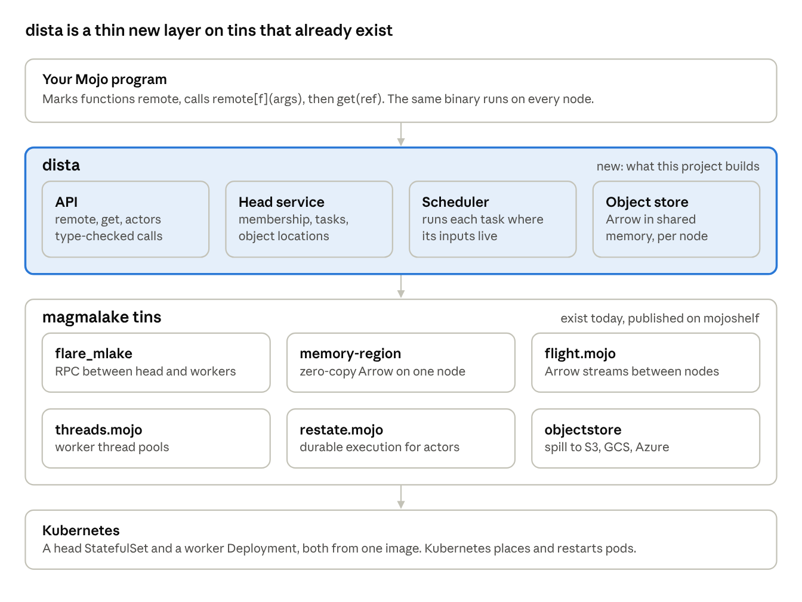

# dista: vision

October 31, 2026

dista lets you write a distributed program in Mojo: mark a function remote, call it, and the work runs across a cluster. Every node runs the same compiled binary, so tasks are typed, nothing is pickled, and data moves as Arrow without copies.

Only the shaded layer is new. Everything under it is a published magmalake tin or Kubernetes itself.

## Why

Mojo can now do real data work on one machine, but it has no native way to spread that work across many. magmalake reads and writes Iceberg, Parquet and Arrow in pure Mojo, with multi-core scans. The next step up, a cluster, still means handing control to a Python framework.

- **Ray, Spark and Dask are Python- or JVM-first.** Mojo code runs only as a guest behind them: a subprocess or an extension module, called from Python tasks.
- **They move work by serializing code.** Ray pickles functions and closures. Mojo compiles ahead of time and can't load code at run time, so that model doesn't carry over.
- **The data path crosses languages.** Each hop between Mojo and the host framework is a copy or a conversion. That gives away the speed that made Mojo worth using.

dista is the missing layer: the Ray programming model, rebuilt around what Mojo is good at.

## Principles

1. **One binary, everywhere.** Every node runs the same compiled program, so every remote function already exists on every worker. A task is a function ID plus its arguments. Deploying new code means rolling out a new image.
2. **Typed all the way through.** `remote[f](args)` is checked by the compiler like a local call. Anything that crosses the wire must implement `Serializable`; closures don't cross it.
3. **Arrow is the data plane.** Columnar results stay as Arrow. They're shared between processes on one node without copying, and streamed between nodes over Arrow Flight.
4. **Ownership, not a central bottleneck.** As in Ray, the caller that creates a result owns it. The head service tracks membership and object locations, not every value.
5. **Built from tins, not from scratch.** RPC, shared memory, Flight, thread pools, durable execution and object storage already exist as magmalake tins. dista adds the scheduler, the object store and the API on top.
6. **Small and explainable.** A core one person can read in an afternoon beats a feature list. Each feature has to earn its place against a real workload.

## Who it's for

The first users are people already writing data code in Mojo, who have outgrown one machine. The first workloads are batch jobs over a data lake:

- **Distributed Iceberg scans.** One task per data file or row group, results gathered as Arrow, using iceberg-mojo and parquet.
- **Aggregations and joins.** Map tasks that partition by key, reduce tasks that combine. The NYC taxi query suite is the first benchmark.
- **Parallel writes.** Each worker writes its own Parquet files, and one commit adds them all to the Iceberg table.

Later, the same core serves stateful work: actors that hold a model, a cache or a connection pool and take ordered method calls.

## Non-goals

- **Not a Ray clone or Ray-compatible.** dista borrows Ray's model (tasks, actors, object refs, ownership), not its API or wire protocol. It doesn't run Python tasks.
- **No shipping code at run time.** No pickled closures, no loading new functions into a running cluster. New code arrives as a new image.
- **Not a cluster manager.** Kubernetes places pods, restarts them and scales them. dista schedules tasks inside the pods it's given.
- **Not a dataframe or SQL engine.** dista runs the tasks; libraries like iceberg-mojo and parquet do the data work inside them.
- **Not multi-tenant at first.** One job per cluster, trusted code, no per-user isolation or quotas.

## Where it goes

Each phase ends at a gate: a working demo, not a feature list.

1. **One machine, many processes.** `remote[f](args) -> ObjectRef` and `get(ref)`, a head service, workers and the function registry, talking over flare. *Gate:* a fan-out and gather of 1,000 tasks runs correctly across 4 local worker processes.
2. **A real cluster.** A shared-memory object store on each node, Arrow Flight between nodes, and deployment on Kubernetes from plain manifests (head StatefulSet, worker Deployment). *Gate:* a distributed Iceberg scan of the taxi data on a 3-node cluster returns the same answer as one machine.
3. **Actors.** Stateful structs that take ordered method calls, placed and restarted by the head. *Gate:* a long-lived actor survives its worker restarting, with its state restored.
4. **Hardening.** Lost objects rebuilt by re-running the tasks that made them, data-aware scheduling, and a Kubernetes operator with autoscaling. *Gate:* the taxi suite finishes with a worker killed mid-run.

## What success looks like

dista works if a Mojo program goes from one machine to a cluster without changing how it's written, and without getting slower per core. The numbers below are proposed starting targets, to be checked against Ray in the design phase.

| Target | Proposed bar | Why it matters |
| --- | --- | --- |
| Scaling | Taxi suite on 4 nodes runs at least 3× faster than on 1 | The point of a cluster |
| Task overhead | Under 1 ms per empty task, end to end on one node | Small tasks stay worth sending |
| Data movement | No copy for Arrow results within a node | Keeps Mojo's speed through the data path |
| Code change | A single-machine program becomes distributed by adding `remote` and `get` | The programming model is the product |
| Recovery | A killed worker costs re-running its tasks, not the whole job | Batch jobs finish on real clusters |
| Core size | Under 10k lines, outside the tins it builds on | Small and explainable |

## Decisions

Dista will be a tin on Magmalake.

First focus will be on data batch work.

We will try to use Serializable for plain structs, but big data should use Arrow.

Placing work on GPUs is desirable.

## Open questions

- [ ] **Concurrency model:** threads plus flare's reactor, since Mojo has no mature async. Is that enough for a head service handling thousands of tasks a second?
- [ ] **Testing a concurrent runtime:** ThreadSanitizer fails on allocating threaded Mojo programs today. What stands in for it?
